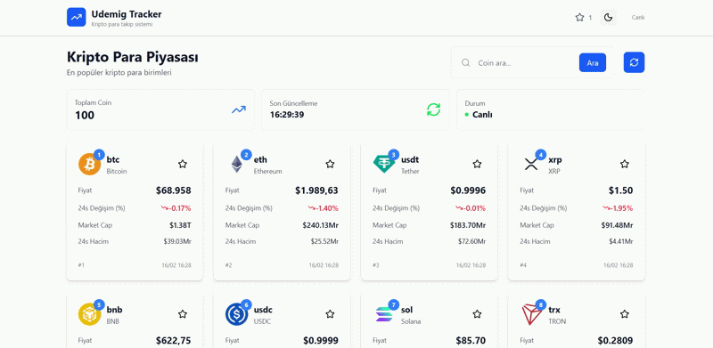

# Crypto App

Küçük, hızlı bir React + Vite tabanlı kripto para uygulaması. Uygulama; kripto para listesi, arama, detay sayfası ve fiyat grafikleri gibi temel özellikleri sağlar.

**Teknolojiler:** React, Vite, JavaScript, CSS

## Ekran Görüntüsü



**Özellikler:**

- **Listeleme:** Popüler kripto paraların listesi
- **Arama:** Coin arama ve filtreleme
- **Detay sayfası:** Coin bilgileri, fiyat, istatistik ve açıklama
- **Fiyat grafiği:** Zaman aralıklı fiyat grafiği
- **Tema:** Basit tema/context yönetimi

## Kurulum

Gerekli: Node.js (v16+ önerilir)

1. Depoyu klonlayın:

```bash
git clone <repo-url>
cd "Crypto App"
```

2. Bağımlılıkları yükleyin ve geliştirme sunucusunu başlatın:

```bash
npm install
npm run dev
```

3. Üretim için derleme:

```bash
npm run build
npm run preview
```

## Proje Yapısı (Öne çıkanlar)

- **src/**: Uygulama kaynak kodu
  - **components/**: Tekrar kullanılabilir bileşenler (home, detail, layout, loader)
  - **pages/**: Sayfa bileşenleri (home, detail)
  - **services/coinApi.js**: API istekleri
  - **context/theme-context.jsx**: Tema yönetimi

## API

Coin verileri için dahili bir servis (`src/services/coinApi.js`) kullanılır — CoinGecko veya benzeri bir dış API'ye istek atıyor olabilir. Eğer özel bir API anahtarı gerekiyorsa, ilgili dosyayı veya çevresel değişkenleri düzenleyin.

## Dağıtım

Projeyi GitHub Pages, Vercel veya Netlify gibi servislerle kolayca dağıtabilirsiniz. `npm run build` ile oluşturulan `dist/` klasörünü deploy edin.

## Katkıda Bulunma

İyileştirme önerileri veya hata bildirimleri için issue açabilirsiniz. Pull request'ler memnuniyetle karşılanır.

## Lisans

Bu proje için lisans bilgisi eklenmemiştir — isterseniz `LICENSE` dosyası ekleyin.

---

README güncellendi. Bu repo'yu GitHub'a atarken README'nin İngilizce versiyonunu veya rozet (badge) eklememi ister misiniz?
